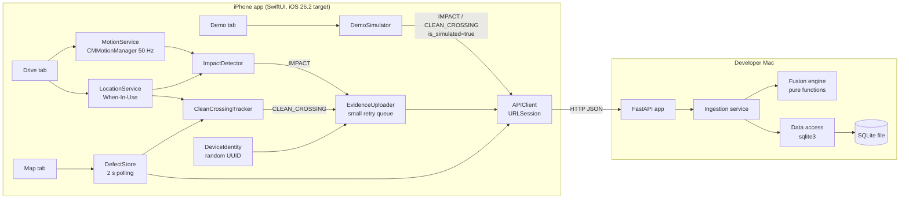
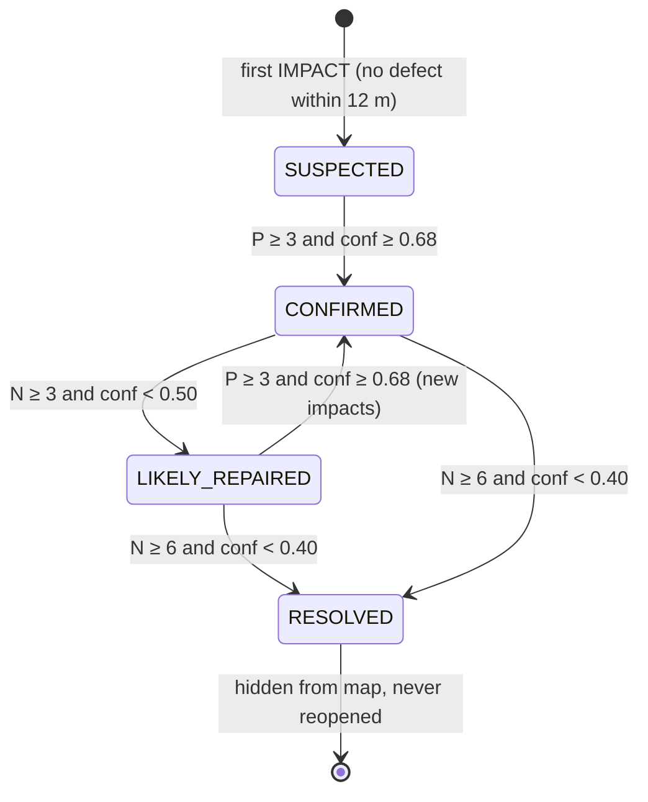
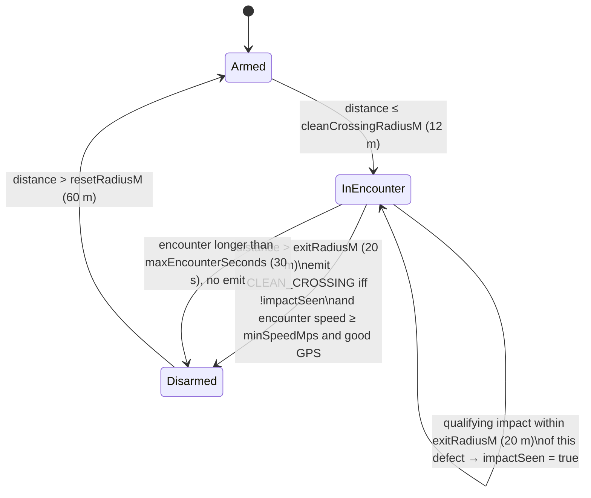

# Design Document: Pothole Mesh MVP

## Overview

Pothole Mesh turns ordinary iPhones into a distributed road-condition sensor network. Each phone runs lightweight signal processing on Core Motion data and reports only compact, infrastructure-relevant evidence: an **IMPACT** when it feels an unusual jolt, and a **CLEAN_CROSSING** when it drives over a known defect location without one. No single phone is trusted. A small FastAPI + SQLite backend clusters evidence spatially into canonical **RoadDefect** entities, scores confidence with a Bayesian-inspired formula that rewards independent devices, and moves each defect through a lifecycle: `SUSPECTED → CONFIRMED → LIKELY_REPAIRED → RESOLVED`.

The system has exactly two components: a native SwiftUI iPhone app (tabs: Map, Drive, Demo) and a local Python backend reachable over the LAN. The Demo tab contains a traffic simulator that posts synthetic evidence to the **same** `POST /evidence` endpoint real phones use, so the judged demo exercises the real fusion engine end to end. The app never fakes map state; the Map only renders what the backend returns.

Design priorities follow the steering order: (1) backend fusion and lifecycle with tests, (2) app shell and live map, (3) simulator-driven vertical slice, (4) sensors and Drive UI, (5) real impact and clean-crossing detection, (6) hardening and polish. Everything is intentionally boring: REST, 2-second polling, one SQLite file, deterministic logic, and constants in one place on each side.

## Architecture



Key decisions:

- **Single ingestion path.** Real and simulated evidence hit `POST /evidence` and run the same `ingest_evidence()` function. `is_simulated` is stored for transparency only and never branches fusion logic.
- **Simulator lives in the app.** The Demo tab owns the simulator and talks HTTP like any phone. The backend has no simulator code beyond `POST /demo/reset`.
- **Polling, not push.** The app polls `GET /defects` every 2 s while in the foreground. One poll loop feeds both the Map and the Drive clean-crossing tracker.
- **Recompute, don't increment.** After each insert, the backend recomputes a defect's counts, centroid, confidence, and severity from its evidence rows. At demo scale this is cheap and avoids counter drift.
- **Serialized ingestion.** A process-level lock plus one SQLite transaction per ingest makes clustering atomic, so two concurrent impacts can't create two defects at the same spot.

### Main flow: impact ingestion

```mermaid
sequenceDiagram
  participant P as Phone / Simulator
  participant A as FastAPI POST /evidence
  participant I as Ingestion
  participant F as Fusion engine
  participant D as SQLite

  P->>A: EvidenceIn (type=impact)
  A->>A: validate (pydantic)
  A->>I: ingest_evidence(e)
  I->>D: BEGIN; duplicate check
  I->>D: load non-resolved defects
  I->>F: find_cluster(defects, lat, lon, radius)
  alt match within radius
    I->>D: insert evidence (defect_id = match)
  else no match
    I->>D: insert SUSPECTED defect + evidence
  end
  I->>D: load defect aggregates
  I->>F: confidence, severity, next_state
  I->>D: update defect; COMMIT
  I-->>A: IngestResult (defect, created, transition)
  A-->>P: 200 JSON
```

A clean crossing follows the same path, except it skips clustering and attaches to the referenced `road_defect_id`.

## Components and Interfaces

### Backend (`server/`)

| Module | Responsibility |
|---|---|
| `app/config.py` | **All** tunables: clustering radius, confidence weights, lifecycle thresholds, severity window, dedupe window, validation limits, DB path, demo reset toggle. |
| `app/schemas.py` | Pydantic models: `EvidenceIn`, `DefectOut`, `IngestResult`, `Transition`. Field validation (ranges, required-by-type). |
| `app/db.py` | `sqlite3` connection factory, schema creation on startup, small repository functions (`insert_defect`, `insert_evidence`, `find_duplicate`, `list_active_defects`, `get_defect`, `defect_aggregates`, `update_defect`, `reset_all`). No ORM. |
| `app/fusion.py` | Pure, deterministic functions with no I/O: `haversine_m`, `find_cluster`, `compute_confidence`, `aggregate_severity`, `next_state`. |
| `app/ingest.py` | `ingest_evidence(conn, evidence, cfg) -> IngestResult`. Orchestrates dedupe, clustering, insert, recompute, and lifecycle under a lock and transaction. Used by the route for both real and simulated evidence. |
| `app/main.py` | FastAPI app and the five routes. Maps domain errors to HTTP codes. |
| `tests/` | pytest suites for fusion functions and API-level scenarios using `TestClient` with a temp SQLite file. |

### iOS (`PotholeMesh/PotholeMesh/`)

| Type | Responsibility |
|---|---|
| `PotholeMeshApp` (existing) | Creates shared services, injects them via SwiftUI environment, and starts or stops defect polling on `scenePhase`. |
| `ContentView` (existing, repurposed) | Root `TabView` with exactly three tabs: Map, Drive, Demo. |
| `AppConfig` | API base URL (default from a constant, overridable and persisted in `UserDefaults` via a field in the Demo tab), poll interval, request timeout. |
| `DetectionConfig` | Single struct with every sensing constant (see [Impact detection](#impact-detection-on-device)). |
| `DeviceIdentity` | Generates a random UUID on first launch and stores it in `UserDefaults`. No other identity. |
| `APIClient` | `async` URLSession wrapper: `health()`, `postEvidence(_:)`, `defects()`, `defect(id:)`, `resetDemo()`. Decodes with `JSONDecoder` (ISO-8601). Throws typed `APIError` (unreachable, timeout, http(status), decoding). Protocol-backed so stores and simulator can be tested with a fake. |
| `DefectStore` (`@Observable`) | Holds `[RoadDefect]`, last refresh time, and connection status. Runs one 2 s poll loop while the app is active. |
| `EvidenceUploader` (`@Observable`) | Uploads real evidence and owns an in-memory FIFO retry queue. Exposes `uploadedCount` and `pendingCount`. |
| **Map** — `MapTabView`, `DefectMarker`, `DefectDetailSheet` | MapKit `Map` with `Annotation`s, selection, and a bottom sheet with stats. |
| **Drive** — `DriveSession` (`@Observable`) | Orchestrates one sensing session: owns `MotionService`, `LocationService`, `ImpactDetector`, and `CleanCrossingTracker`, and publishes the UI state (status, GPS, speed, duration, impacts, uploads, recent magnitudes). |
| `MotionService` | Owns the single `CMMotionManager`. Delivers `MotionSample(t, accelMagnitudeG, rotationRateRadS)` at `DetectionConfig.sampleHz`. |
| `LocationService` | `CLLocationManager` delegate wrapper (When-In-Use, best-for-navigation accuracy, no background). Publishes the latest `LocationFix` and authorization status. Drops stale or inaccurate fixes. |
| `ImpactDetector` | Pure value type. `process(sample, context) -> ImpactEvent?` using a rolling 2 s window. Unit tested with synthetic samples. |
| `CleanCrossingTracker` | Pure value type. `update(fix, activeDefects, now) -> [CleanCrossingEvent]` and `noteImpact(at: LocationFix, time: Date)`, which marks `impactSeen` only on InEncounter encounters whose defect is within `DetectionConfig.exitRadiusM` (20 m) of the impact position. Unit tested. |
| **Demo** — `DemoSimulator` (`@Observable`) | Ground-truth virtual pothole plus a virtual traffic loop that posts through `APIClient`. Tracks the demo defect id and status. |
| `DemoEventLog` | Bounded list (last 50) of human-readable events derived from ingest responses. |
| `DemoTabView` | Status card, controls, log, and server URL/health row. |

## Proposed File Layout

```
server/
  requirements.txt          # fastapi, uvicorn, pytest, httpx (pinned versions)
  app/
    __init__.py
    config.py
    schemas.py
    db.py
    fusion.py
    ingest.py
    main.py
  tests/
    conftest.py             # temp DB + TestClient fixture
    test_fusion.py
    test_api_lifecycle.py
  data/                     # pothole_mesh.db (gitignored)

PotholeMesh/
  PotholeMesh-Info.plist    # partial plist (ATS + local network), outside synced group
  PotholeMesh/
    PotholeMeshApp.swift    # existing, extended
    ContentView.swift       # existing, becomes root TabView
    Config/   AppConfig.swift, DetectionConfig.swift
    Models/   RoadDefect.swift, Evidence.swift, APIModels.swift
    Services/ APIClient.swift, DeviceIdentity.swift, DefectStore.swift, EvidenceUploader.swift
    Map/      MapTabView.swift, DefectMarker.swift, DefectDetailSheet.swift
    Drive/    DriveTabView.swift, DriveSession.swift, MotionService.swift, LocationService.swift,
              ImpactDetector.swift, CleanCrossingTracker.swift, AccelerationChart.swift
    Demo/     DemoTabView.swift, DemoSimulator.swift, DemoEventLog.swift
  PotholeMeshTests/
    ImpactDetectorTests.swift, CleanCrossingTrackerTests.swift   # XCTest (matches existing target)
```

### Xcode project notes (preserve, never recreate)

- The project uses **file-system synchronized groups**, so new Swift files under `PotholeMesh/PotholeMesh/` and `PotholeMeshTests/` join their targets automatically. No `pbxproj` file-reference edits are needed.
- The Info.plist is generated (`GENERATE_INFOPLIST_FILE = YES`). Privacy strings go in as app-target build settings:
  - `INFOPLIST_KEY_NSMotionUsageDescription = "Pothole Mesh uses motion sensors while you drive to detect road impacts like potholes. Raw motion data never leaves your phone."`
  - `INFOPLIST_KEY_NSLocationWhenInUseUsageDescription = "Pothole Mesh uses your location only while sensing to tag road impacts and confirm repaired roads. Your route is never uploaded."`
- Plain HTTP to the Mac's LAN IP needs ATS `NSAllowsLocalNetworking = YES`, plus `NSLocalNetworkUsageDescription` for the local-network prompt. ATS dictionaries can't be expressed as `INFOPLIST_KEY_*` settings, so they go in a small partial plist, `PotholeMesh/PotholeMesh-Info.plist`, referenced by `INFOPLIST_FILE`. Xcode merges it with the generated keys. The file sits **outside** the synchronized `PotholeMesh/PotholeMesh/` folder so it isn't also copied as a resource.
- The project sets `IPHONEOS_DEPLOYMENT_TARGET = 26.2`, and the physical demo iPhone runs iOS 26.6.2. The deployment target is **preserved unchanged at 26.2** for this MVP. Backwards compatibility with older iOS versions is not needed during the hackathon, so there is no constraint to avoid newer APIs. The design itself only relies on `@Observable`, SwiftUI `Map` with `Annotation`, and Swift Charts.
- The project uses Swift 5 language mode with `SWIFT_DEFAULT_ACTOR_ISOLATION = MainActor` and approachable concurrency, built with the Swift 6 toolchain. The design keeps that: UI state is MainActor-isolated, and motion updates are delivered on `OperationQueue.main`, which 50 Hz handles comfortably. Switching to Swift 6 strict language mode is optional and out of the critical path.

## Data Models

### SQLite tables

```sql
CREATE TABLE road_defect (
  id                            INTEGER PRIMARY KEY AUTOINCREMENT,
  latitude                      REAL    NOT NULL,
  longitude                     REAL    NOT NULL,
  state                         TEXT    NOT NULL CHECK (state IN ('SUSPECTED','CONFIRMED','LIKELY_REPAIRED','RESOLVED')),
  confidence                    REAL    NOT NULL,
  severity                      REAL    NOT NULL,          -- 0..100
  positive_observation_count    INTEGER NOT NULL DEFAULT 0, -- O
  positive_unique_device_count  INTEGER NOT NULL DEFAULT 0, -- P
  clean_crossing_count          INTEGER NOT NULL DEFAULT 0, -- C
  clean_unique_device_count     INTEGER NOT NULL DEFAULT 0, -- N
  first_seen                    TEXT    NOT NULL,           -- ISO-8601, earliest IMPACT
  last_seen                     TEXT    NOT NULL,           -- ISO-8601, latest IMPACT
  created_at                    TEXT    NOT NULL,
  updated_at                    TEXT    NOT NULL
);

CREATE TABLE evidence (
  id                 INTEGER PRIMARY KEY AUTOINCREMENT,
  road_defect_id     INTEGER NOT NULL REFERENCES road_defect(id) ON DELETE CASCADE,
  device_id          TEXT    NOT NULL,                    -- pseudonymous UUID
  type               TEXT    NOT NULL CHECK (type IN ('impact','clean_crossing')),
  latitude           REAL    NOT NULL,
  longitude          REAL    NOT NULL,
  timestamp          TEXT    NOT NULL,
  speed_mps          REAL,
  gps_accuracy_m     REAL,
  impact_score       REAL,                                -- impact only
  peak_acceleration  REAL,                                -- impact only (g)
  peak_jerk          REAL,                                -- impact only (g/s)
  rotation_rate      REAL,                                -- impact only (rad/s)
  is_simulated       INTEGER NOT NULL DEFAULT 0,
  created_at         TEXT    NOT NULL
);
CREATE INDEX idx_evidence_defect ON evidence(road_defect_id);
CREATE INDEX idx_evidence_device ON evidence(device_id, type, timestamp);
```

The stored counts are denormalized for fast `GET /defects`. They're recomputed with `COUNT(*)` and `COUNT(DISTINCT device_id)` after every insert.

### Validation rules (`EvidenceIn`)

- `device_id`: non-empty string, ≤ 64 chars (UUID expected).
- `type` ∈ {`impact`, `clean_crossing`}.
- `latitude` ∈ [-90, 90], `longitude` ∈ [-180, 180].
- `timestamp`: ISO-8601, no more than `MAX_FUTURE_SKEW_S` (300 s) in the future.
- `speed_mps` ≥ 0 when present. `gps_accuracy_m` in (0, `MAX_GPS_ACCURACY_M` = 30] when present.
- **impact**: `impact_score` ∈ [0, 100] is required. `peak_acceleration`, `peak_jerk`, and `rotation_rate` are ≥ 0 when present. Any client-sent `road_defect_id` is ignored because the server clusters.
- **clean_crossing**: `road_defect_id` is required and must exist (else 404). It must not be `RESOLVED` (else 409). The reported position must be within `CLEAN_CROSSING_MAX_DISTANCE_M` (40 m) of the defect (else 422). Impact-only fields are ignored and stored as null.

### Duplicate rule

Evidence counts as a duplicate when an existing row has the **same `device_id` and `type`**, a **timestamp within `DEDUPE_WINDOW_S` (2 s)**, and the same target: the same `road_defect_id` for clean crossings, or a position within the clustering radius for impacts. Duplicates are not inserted. The response is 200 with `duplicate: true` and the unchanged defect. This makes client retries idempotent, since a retried payload carries the original timestamp.

### iOS models

`RoadDefect` (Codable, Identifiable) mirrors `DefectOut`. `DefectState` is a String enum with display name, color, and SF Symbol. `EvidencePayload` mirrors `EvidenceIn`. `IngestResponse` mirrors `IngestResult`. All JSON uses snake_case through `keyDecodingStrategy = .convertFromSnakeCase`.

## REST API Contract

| Method | Path | Purpose | Response |
|---|---|---|---|
| GET | `/health` | Liveness for the app's connection indicator | `{"status":"ok"}` |
| POST | `/evidence` | Ingest one impact or clean crossing (real or simulated) | `IngestResult` |
| GET | `/defects` | All **non-resolved** defects | `[DefectOut]` |
| GET | `/defects/{id}` | One defect, any state (lets Demo show RESOLVED) | `DefectOut` or 404 |
| POST | `/demo/reset` | Delete all evidence and defects (disabled if `DEMO_RESET_ENABLED=False`) | `{"status":"reset"}` |

Request bodies follow the examples in the user specification. Response shapes:

```json
// DefectOut
{"id":1,"latitude":42.35501,"longitude":-71.06498,"state":"CONFIRMED","confidence":0.70,
 "severity":64.0,"positive_observation_count":3,"positive_unique_device_count":3,
 "clean_crossing_count":0,"clean_unique_device_count":0,
 "first_seen":"…","last_seen":"…","created_at":"…","updated_at":"…"}

// IngestResult
{"evidence_id":17,"duplicate":false,"created":false,
 "transition":{"from":"SUSPECTED","to":"CONFIRMED"},   // null when state unchanged
 "defect":{ …DefectOut… }}
```

Errors: 422 for validation (FastAPI default body), 404 for an unknown defect, 409 for a clean crossing against a resolved defect. The client treats 4xx as non-retryable and drops the item. It treats network errors and 5xx as retryable.

## Evidence Fusion and Lifecycle

### Spatial clustering (IMPACT only)

1. Load defects with `state != 'RESOLVED'`.
2. Compute `haversine_m(impact, defect)` for each and take the nearest.
3. If nearest ≤ `CLUSTER_RADIUS_M` (12 m), attach to it. Otherwise create a new `SUSPECTED` defect at the impact position.
4. Canonical position = mean lat/lon of all IMPACT evidence on the defect. This is equivalent to moving the position incrementally toward the centroid with step `1/O`, so early points move it a lot and later ones barely at all. No map matching.

An impact near a `RESOLVED` defect never attaches to it, so it creates a new `SUSPECTED` defect (intentional scope reduction: no reopening).

### Confidence

With P = unique positive devices, O = positive observations, N = unique clean-crossing devices, C = clean crossings:

```
alpha      = 1 + 2.0·P + 0.25·max(O − P, 0)
beta       = 3 + 1.5·N + 0.15·max(C − N, 0)
confidence = alpha / (alpha + beta)
```

All six weights live in `config.py` (`PRIOR_ALPHA`, `W_POS_DEVICE`, `W_POS_REPEAT`, `PRIOR_BETA`, `W_NEG_DEVICE`, `W_NEG_REPEAT`).

### Lifecycle



`next_state(state, P, N, conf)` is a pure function applied after every ingest, in this order:

1. If the state is CONFIRMED or LIKELY_REPAIRED and the RESOLVED condition holds → RESOLVED.
2. Else if the state is CONFIRMED and the LIKELY_REPAIRED condition holds → LIKELY_REPAIRED.
3. Else if the state is SUSPECTED or LIKELY_REPAIRED and the CONFIRMED condition holds → CONFIRMED.
4. Else unchanged.

A SUSPECTED defect that only collects clean crossings stays SUSPECTED with falling confidence. The MVP has no expiry. The `LIKELY_REPAIRED → CONFIRMED` edge is a one-line re-evaluation of the existing confirm rule, not a new feature. The response reports `{from, to}` when the state changes.

### Severity

Each IMPACT carries `impact_score` ∈ [0, 100]. Defect severity uses the most recent `SEVERITY_WINDOW` (20) impacts:

```
severity = median over devices d of ( median of impact_score for device d in window )
```

Taking the per-device median first stops one device that reports often from dominating. The app maps severity to bands for marker styling: low < 40 ≤ moderate < 70 ≤ high.

### Do the default thresholds allow the full demo sequence?

With no repeated device ids (O = P, C = N), the defaults reduce to closed forms:

| Condition | Requirement |
|---|---|
| CONFIRMED | P ≥ 3 (P = 3 gives 7/10 = 0.70 ≥ 0.68; P = 2 gives 0.625) |
| LIKELY_REPAIRED | N ≥ 3 and 3 + 1.5N > 1 + 2P, i.e. **N > (4P − 4)/3** |
| RESOLVED | N ≥ 6 and 3 + 1.5N > 1.5·(1 + 2P), i.e. **N ≥ 2P** |

Confidence with no negatives: P=1 → 0.50, 2 → 0.63, 3 → 0.70, 5 → 0.79, 8 → 0.85, 15 → 0.91.

**Finding:** to resolve a defect, the number of unique clean-crossing devices must reach about **twice** the number of unique positive devices. If the simulator reused a fixed pool of, say, 10 device ids, a defect confirmed by all 10 could reach at most N = 10 < 2P = 20. It would then need about 115 additional repeat crossings at 0.15 each, and the demo would stall in CONFIRMED or LIKELY_REPAIRED.

**Resolution (no change to the user's fusion defaults):** each virtual **trip** is a new anonymous vehicle crossing the location and gets a fresh synthetic device UUID. The "TRAFFIC RATE: Low / Medium / High" control sets only how often trips happen. There is no fixed pool of persistent device identities. This also matches reality, since passing traffic is mostly distinct vehicles. The confidence weights and lifecycle thresholds stay exactly as specified.

## Demo Simulator

**Ground truth (local to the simulator only):** `hasPothole`, `isRepaired`, and the demo coordinate `42.35500, -71.06500` in Boston. The backend learns about the pothole **only** through evidence.

**Traffic loop:** one Swift `Task`, cancelled on pause.

- Trip interval = `BASE_LAP_S (10 s) / rateFactor / speed`, with rateFactor Low = 3, Medium = 10, High = 25. At 1x that is one trip every 3.3 s (Low), 1.0 s (Medium), or 0.4 s (High). For example, Medium at 2x gives 0.5 s and High at 5x gives 0.08 s. The loop waits one interval, then posts, so the first trip happens one interval after START.
- Trips are numbered by a sequence number `k` (1, 2, 3, …), reset to 1 on RESET DEMO. Each trip is a new anonymous vehicle: it gets a fresh UUID and a label derived from k (`Vehicle 01`, `Vehicle 02`, …) used only in the log.
- **Deterministic variation (no randomness).** Every evidence value is a pure function of k:
  - Position: golden-angle spiral around the demo coordinate. `θ = k · 137.508°`, `r = 6 m · sqrt(((k − 1) mod 16 + 1) / 16)`, converted to lat/lon offsets (`Δlat = r·cosθ / 111 320`, `Δlon = r·sinθ / (111 320 · cos lat)`). Every trip stays ≤ 6 m from the demo coordinate, well inside the 12 m cluster radius.
  - `impact_score` = `SCORES[(k − 1) mod 8]` with `SCORES = [58, 72, 64, 69, 55, 76, 61, 67]` (mean ≈ 65, all within [20, 100]).
  - `peak_acceleration` = `0.4 + score / 50` g, `peak_jerk` = `10 + score / 2` g/s, `rotation_rate` = `0.6 + 0.1 · (k mod 5)` rad/s.
  - `speed_mps` = `8 + (3k mod 7)` (8–14), `gps_accuracy_m` = `3 + (k mod 6)` (3–8).
- **Before repair:** **every** trip posts IMPACT with the values above.
- **After repair:** **every** trip posts CLEAN_CROSSING with `road_defect_id = demoDefectId` (position, speed, and accuracy from the same formulas).
- Timestamps use the actual current time, which validation needs. Timestamps don't affect fusion outcomes, because fresh per-trip UUIDs never trigger the same-device dedupe rule.
- Requests are **serialized** (await each POST). At high rates the effective rate is bounded by round-trip time, and ordering stays deterministic.
- **Determinism.** RESET DEMO always returns the simulator to the exact same initial sequence: k = 1, `hasPothole = false`, `isRepaired = false`, the same parameter sequence, a cleared log, and a cleared `demoDefectId`. UUID values don't affect fusion outcomes, only their uniqueness does. So the same control sequence (same number of trips in each phase) yields the same evidence values, the same log labels, and the same fusion outcomes on every run.

**Defect id:** `demoDefectId` is taken from the first IMPACT's `IngestResult.defect.id`. If REPAIR is pressed before any defect exists, the simulator posts nothing until a defect id is known. When the defect reaches RESOLVED (seen from the ingest transition, or from a 409 on a later clean-crossing post), the simulator stops sending clean crossings. Traffic keeps "driving" silently until the user pauses or resets.

**Controls:**

| Control | Action |
|---|---|
| RESET DEMO | Pause traffic, `POST /demo/reset`, reset k to 1 and ground truth to initial, clear `demoDefectId` and log |
| INJECT POTHOLE | `hasPothole = true`, `isRepaired = false` |
| START / PAUSE TRAFFIC | Start or cancel the loop |
| TRAFFIC RATE | Low / Medium / High (segmented control; trip every 3.3 s / 1.0 s / 0.4 s at 1x) |
| SIMULATION SPEED | 1x / 2x / 5x (segmented control) |
| REPAIR POTHOLE | `isRepaired = true` |

**Event log:** derived only from `IngestResult`. Examples: "Vehicle 03: impact detected (score 64)", "Defect #1 created · suspected", "Defect #1 confirmed", "Vehicle 12: clean crossing", "Defect #1 likely repaired", "Defect #1 resolved". Backend failures are logged as "Server unreachable, retrying".

**Making transitions obvious:** a large status card shows the demo defect's state pill (color matches the map marker), confidence %, P/N counts, and severity. It refreshes from each ingest response, falling back to `GET /defects/{id}`. On a transition, the pill animates, a short banner appears, and a haptic fires.

**Suggested 1–2 minute script (default thresholds):**

| Step | Setting | Expected |
|---|---|---|
| Reset, inject, start | Low @ 1x (trip every 3.3 s) | Trip 1 (~3.3 s) → impact → SUSPECTED. Trip 3 (~10 s) → P=3 → CONFIRMED |
| Build evidence | switch to Medium @ 1x (1 trip/s), ~8 s | 8 more trips → P = 11, confidence ~0.88, severity settles |
| Repair | Medium @ 2x (2 trips/s) | P=11: LIKELY_REPAIRED at N=14 (~7 s), RESOLVED at N=22 (~11 s) |

In general, the repair phase needs about 2P clean trips, so the longer traffic runs before repair, the longer resolution takes. The script keeps P around 10 so the whole sequence finishes in about 1 minute.

Threshold comparisons use confidence rounded to 6 decimals so that boundary cases are deterministic. Example: P=11, N=21 gives exactly 0.40, which is not below the threshold. Starting at Low @ 1x keeps SUSPECTED visible for about 6.7 s (trips 1–2), which spans at least one 2 s map poll.

## On-Device Sensing (Drive)

### Impact detection (on device)

**Motion pipeline:** `CMMotionManager.deviceMotionUpdateInterval = 1/sampleHz` (50 Hz). Each sample computes:

- `m = |userAcceleration|` in g (orientation-independent, gravity excluded)
- `r = |rotationRate|` in rad/s
- `jerk = (m − m_prev)·sampleHz` in g/s

A ring buffer holds the last `windowSeconds` (2 s ≈ 100 samples), from which the rolling mean μ and standard deviation σ are computed. σ is floored at `sigmaFloorG` so a smooth road doesn't produce runaway z-scores.

**Candidate gate.** A candidate requires all of the following:

| Gate | Default (tunable in `DetectionConfig`) |
|---|---|
| Session active, location fix fresh (≤ 5 s) and accurate | `maxHorizontalAccuracyM = 20` |
| Speed | `minSpeedMps = 4.0` (~9 mph) |
| Deviation `z = (m − μ)/max(σ, sigmaFloorG)` | `zThreshold = 4.0`, `sigmaFloorG = 0.03` |
| Peak magnitude | `minPeakG = 0.35` |
| Jerk | `jerkThresholdGps = 8.0` |
| Rotation not phone-handling-like | `maxRotationRadS = 3.0` |
| Cooldown since last event | `cooldownSeconds = 2.0` |

When the gate trips, the detector captures for `captureSeconds` (0.25 s) to record peak m, peak |jerk|, peak r, and the duration above μ + 2σ. The window baseline uses pre-event samples. Then it emits an `ImpactEvent`.

**Impact score (transparent, no ML):** with `n(x, lo, hi) = clamp((x − lo)/(hi − lo), 0, 1)`:

```
raw   = 0.35·n(z, zThreshold, 12) + 0.25·n(peakJerk, jerkThreshold, 40)
      + 0.20·n(peakG, minPeakG, 2.5) + 0.10·n(duration, 0.02, 0.20)
      + 0.10·n(speed, minSpeedMps, 20)
score = round(100 · raw · (1 − 0.3·n(peakRotation, 0.5, maxRotationRadS)))
```

All bounds and weights live in `DetectionConfig`. The score is a relative intensity, not a depth estimate.

**On accept:** `DriveSession` builds the IMPACT payload (current fix, peaks, score, `is_simulated=false`), hands it to `EvidenceUploader`, increments the session's impact count, calls `CleanCrossingTracker.noteImpact(at:time:)` with the impact's fix and time, and gives subtle feedback (a light haptic and a counter bump animation).

**Drive UI:** a dominant START / STOP SENSING button and status rows (sensing, GPS: good/poor/denied, speed, session duration, impacts detected, uploaded / pending). A small Swift Charts line of recent `m` downsampled to about 10 Hz, from the in-memory buffer only. If sensing can't safely produce evidence, a clear banner states why: motion unavailable, location denied, poor GPS, too slow, or server unreachable.

### Location

`CLLocationManager` with `requestWhenInUseAuthorization`, `desiredAccuracy = kCLLocationAccuracyBestForNavigation`, `activityType = .automotiveNavigation`, and **no** `allowsBackgroundLocationUpdates`. Updates run only while a session is active. Fixes with `horizontalAccuracy < 0`, `> maxHorizontalAccuracyM`, or older than 5 s are ignored. `speed < 0` is treated as unknown, which fails the speed gate. Fixes stay in memory only. Only the latest fix is kept.

### Clean-crossing detection

`CleanCrossingTracker` keeps a tiny per-defect state machine over the active defects that `DefectStore` already polls:



- The exit radius is larger than the entry radius to give hysteresis against GPS jitter.
- `noteImpact(at:time:)` is location-aware. It sets `impactSeen = true` only for encounters that are currently InEncounter **and** whose defect is within `DetectionConfig.exitRadiusM` (20 m) of the impact position. Encounters for other defects are unaffected, so an impact at one defect can't suppress a legitimate clean crossing at a nearby but different defect.
- The reset radius stops a slow or stationary phone from producing repeated crossings for the same defect.
- Minimum encounter speed matters because impact detection is gated off below `minSpeedMps`. Without an impact check, the absence of an impact isn't evidence.
- The emitted payload carries the exit position, the defect id, speed, and accuracy. The route is never recorded.

### Evidence upload and retry

`EvidenceUploader` posts immediately. On a retryable failure it enqueues the payload in an in-memory FIFO (max 50, drops the oldest) and retries with backoff 2 → 4 → 8 … ≤ 30 s. Server-side dedupe makes retries idempotent. The queue isn't persisted to disk, which keeps location off disk. The request timeout is 5 s.

## Map Tab

- SwiftUI `Map(position:selection:)` with the initial camera on the Boston demo coordinate. It shows `UserAnnotation()` if authorized but never requests permission by itself.
- One `Annotation` per active defect:
  - SUSPECTED: amber outlined circle with `exclamationmark`
  - CONFIRMED: solid red circle with `exclamationmark.triangle.fill`
  - LIKELY_REPAIRED: green/teal circle with `wrench.and.screwdriver.fill`
  - Marker size steps with the severity band (3 sizes). State changes animate.
  - RESOLVED defects drop out of `GET /defects`, so their markers fade away.
- `DefectDetailSheet` (`.presentationDetents([.medium, .large])`, material background) shows a state pill, a confidence `Gauge` with %, the severity score and band, P / O and N / C stats in a card grid, and relative first/last seen. A compact two-segment bar shows positive vs clean evidence. The sheet updates live from `DefectStore` by id.
- A small, unobtrusive connection pill appears only when the backend is unreachable.

## Error Handling

| Scenario | Response | Recovery |
|---|---|---|
| Motion unavailable (`isDeviceMotionAvailable == false`) | Drive shows "Motion sensors unavailable"; Start disabled | None needed; Map and Demo still work |
| Location denied or restricted | Drive banner with a Settings deep link; no evidence produced | Re-checked on authorization change |
| Location unavailable or poor accuracy | GPS status "Searching" or "Poor"; impacts and crossings gated off | Resumes automatically when fixes improve |
| Backend unreachable or timeout (5 s) | Map keeps the last data and shows the connection pill; Drive queues evidence; Demo logs it and keeps its loop alive | Next poll or retry succeeds; the pill clears |
| Malformed response | `APIError.decoding`, logged; state unchanged | Next poll |
| 4xx on evidence (validation, 404, 409) | Item dropped, not retried; Demo logs it | None needed |
| Simulator backend failure | Simulator pauses after 3 consecutive failures and shows "Server unreachable" with Resume | User fixes the URL or server, then resumes |
| Concurrent ingests | Process lock plus a single transaction | n/a |

No force-unwraps on external data. All network calls are `async` with typed errors and no crashes.

## Privacy

"Pothole Mesh observes roads, not people."

- The only identity is a random per-install UUID. No name, email, phone number, account, or advertising id.
- Only discrete IMPACT and CLEAN_CROSSING events are uploaded. No route, location trail, continuous location, or raw motion stream.
- Raw motion lives in a 2 s in-memory ring buffer. Location keeps only the latest fix in memory. The retry queue is in memory only.
- When-In-Use location only, with no background sensing.

## Security Considerations

- **Accepted risk:** the backend is unauthenticated on the local network for the hackathon. Anyone on the LAN could post evidence or call `/demo/reset`. Mitigations: input validation, dedupe, and the `DEMO_RESET_ENABLED` toggle. Run on a trusted network.
- Plain HTTP via `NSAllowsLocalNetworking` only. No arbitrary-loads exception.
- All SQL uses parameterized `sqlite3` queries.

## Correctness Properties

Each property maps to a pytest test (backend) or XCTest (iOS):

### Property 1: Single-impact suspicion
For any impact with no active defect within 12 m, exactly one new defect exists afterward, with state SUSPECTED and P = O = 1.

**Validates: Requirements 1.1, 3.3, 3.6**

### Property 2: Spatial clustering
Any impact within 12 m of an active defect attaches to the nearest one and no new defect is created. An impact farther than 12 m from all active defects creates a new defect.

**Validates: Requirements 1.9, 3.1, 3.2, 3.3, 3.5**

### Property 3: Independent confirmation
Three impacts from three distinct devices at one spot yield CONFIRMED (confidence 0.70). Two distinct devices never do.

**Validates: Requirements 4.1, 5.4, 5.8, 5.9**

### Property 4: Repeat discount
For any k > 1, k impacts from one device produce lower confidence than k impacts from k devices. Repeated same-device impacts never satisfy P ≥ 3.

**Validates: Requirements 3.6, 4.1, 4.6, 5.4**

### Property 5: Evidence monotonicity
Adding a clean crossing never increases confidence, and adding a positive impact never decreases it.

**Validates: Requirements 4.4, 4.5, 5.6**

### Property 6: Repair lifecycle
After confirmation by P devices, N ≥ 3 distinct clean devices with N > (4P − 4)/3 yield LIKELY_REPAIRED, and N ≥ max(6, 2P) yields RESOLVED.

**Validates: Requirements 5.1, 5.2, 5.3, 5.5, 5.7, 22.3, 22.4**

### Property 7: Resolved is terminal
A resolved defect is excluded from `GET /defects`, a clean crossing against it returns 409, and a nearby impact creates a new SUSPECTED defect.

**Validates: Requirements 1.12, 3.4, 5.10, 7.2, 7.3**

### Property 8: Idempotent retry
Re-posting the same payload, or any duplicate inside the dedupe window, leaves all counts and confidence unchanged and returns `duplicate: true`.

**Validates: Requirements 2.1, 2.2, 2.3, 18.2**

### Property 9: Real/simulated path equivalence
Identical evidence sequences with `is_simulated=true` and `false` produce identical defect states, counts, confidence, and severity.

**Validates: Requirements 1.2, 12.1**

### Property 10: Severity robustness
Severity stays in [0, 100]. Within the `SEVERITY_WINDOW` (20) most recent impacts across all devices, each distinct device represented in the window contributes exactly one value (its median score) to the outer median, regardless of how many of the window's impacts come from that device.

**Validates: Requirements 6.1, 6.2, 6.3, 6.4**

### Property 11: Confidence bounds
Confidence lies in (0, 1) for all non-negative P, O, N, C.

**Validates: Requirements 4.3**

### Property 12: iOS impact detector
A flat synthetic signal (noise σ ≈ 0.02 g) never triggers. A single 1.5 g spike at speed ≥ 4 m/s triggers exactly once. The same spike below the minimum speed, with rotation above the maximum, or within the cooldown does not trigger. The score lies in [0, 100] and increases with spike amplitude.

**Validates: Requirements 15.3, 15.4, 15.5, 15.6, 15.7, 15.8, 15.9, 15.10, 15.11**

### Property 13: iOS clean-crossing tracker
A straight pass through a defect with no impact emits exactly one crossing. A pass with an impact within 20 m (`exitRadiusM`) of that defect emits none, while an impact farther than 20 m from it does not suppress its crossing. Lingering or oscillating inside the reset radius emits at most one. A slow pass emits none.

**Validates: Requirements 17.1, 17.2, 17.3, 17.4, 17.5, 17.6, 17.8, 17.9**

## Testing Strategy

- **Backend unit (`test_fusion.py`):** pure-function tests for haversine, clustering, confidence (table of closed-form values), `next_state` transitions, and severity aggregation.
- **Backend API (`test_api_lifecycle.py`):** `TestClient` against a temp SQLite file. Covers every scenario the user specification requires (properties 1–9), plus the full demo sequence posted as raw HTTP.
- **Property-based testing:** properties are checked with parametrized pytest over representative input tables (e.g. ranges of P, O, N, C for properties 5 and 11). Hypothesis is not used in the MVP, to keep backend dependencies to fastapi, uvicorn, pytest, and httpx.
- **iOS logic (XCTest, existing `PotholeMeshTests` target):** `ImpactDetectorTests` and `CleanCrossingTrackerTests` with synthetic samples and fixes. Both types are pure values with injected time, so no hardware is needed. No snapshot or UI tests.
- **Integration (manual, demo checklist):** run the Definition-of-Done flow on a real iPhone against the Mac, then a short real drive or bump test showing a Drive event appear on the Map through the same pipeline.

## Performance Considerations

At demo scale (tens of defects, a few thousand evidence rows) a linear scan with Haversine is enough, with no spatial index. Polling every 2 s on the LAN is trivial. The simulator's serialized posts cap load to one in-flight request. The 50 Hz motion processing does O(window) work per sample, about 100 floats, which is negligible on the main actor. Running stats can be incremental if profiling ever shows a need.

## Dependencies

- **Backend:** Python 3.11+, `fastapi`, `uvicorn`, `pytest`, `httpx` (for `TestClient`), and stdlib `sqlite3`. Exact versions are pinned in `requirements.txt` at implementation. Run with `uvicorn app.main:app --host 0.0.0.0 --port 8000` from `server/`.
- **iOS:** Apple frameworks only: SwiftUI, MapKit, Core Motion, Core Location, Swift Charts, Foundation/URLSession, and XCTest. No third-party packages.

## Non-Goals (Out of Scope)

Android; web client; PWA; user accounts; authentication; social features; gamification; camera detection; computer vision; LLMs; generative AI; neural or ML classifiers; Boston 311 integration; automatic government reporting; OpenStreetMap or road-network map matching; route planning; avoid-pothole navigation; background GPS; background motion sensing; Apple Watch; CarPlay; notifications; PostGIS; WebSockets; microservices, Kafka, Redis, Kubernetes, Firebase, Supabase; complex cloud deployment; municipal admin portal; device reputation system; reopening resolved defects; defect expiry; production-scale security architecture.
